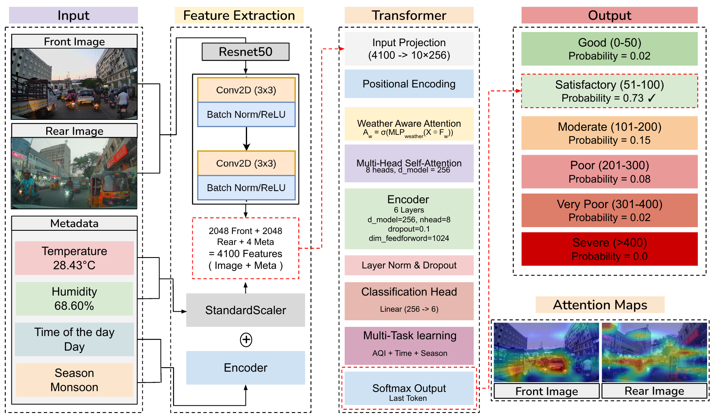
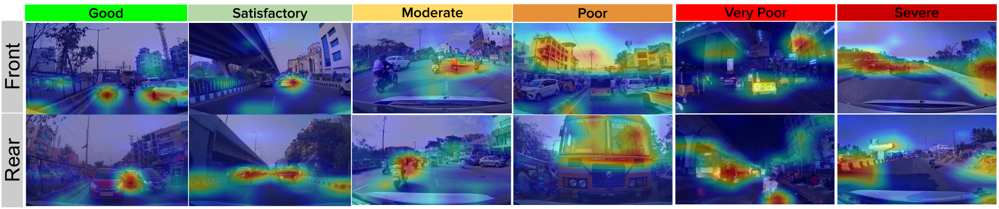
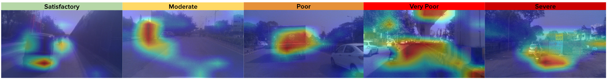

<div align="center">

# AQIFormer: A Transformer-Based Multi-View Architecture for Cross-City Air Quality Classification

**Om Kathalkar · Nitin Nilesh · Sachin Chaudhari · Anoop Namboodiri**

International Institute of Information Technology, Hyderabad, India

*ICVGIP 2025, the 16th Indian Conference on Computer Vision, Graphics and Image Processing, Mandi*

[](https://doi.org/10.1145/3774521.3774577)
[](https://github.com/omkathalkar/TRAQID-Traffic-Related-Air-Quality-Image-Dataset)
[](LICENSE)

</div>

<p align="center">
  
</p>

---

## Overview

**AQIFormer** classifies air quality into the six CPCB AQI categories from **front and rear traffic images** together with **weather parameters**.

It extracts visual features from both camera views with ResNet50 and joins them with temperature, humidity, season and time of day. A transformer with **weather-aware attention** and **multi-task learning** then processes the combined features.

| | |
|---|---|
| **89.96%** accuracy, 0.88 F1 | On [TRAQID](https://github.com/omkathalkar/TRAQID-Traffic-Related-Air-Quality-Image-Dataset), 14.96 points above the best previous method (AQC-Net) |
| **81.67%** accuracy, 0.79 F1 | Cross-city on a new Nagpur dataset after few-shot adaptation with ~120 samples |
| **1.68%** drop at night | 89.84% by day vs. 88.16% at night |

## Method

**1. Feature extraction.** Two ImageNet-pretrained ResNet50 backbones encode the front and rear images into 2048-d features each. Temperature and humidity are standardised, and season and day/night are integer-encoded. All of these are concatenated into a **4100-d** vector.

**2. Dual-view fusion.** The model learns a weight for each view, so it can decide which view matters more in a given scene:

$$\alpha_f, \alpha_r = \mathrm{softmax}(W_{\text{fusion}}[F_f; F_r]), \qquad F_{\text{fused}} = \alpha_f F_f + \alpha_r F_r$$

**3. Transformer encoder.**
- The 4100-d vector is projected to a 10 × 256 token sequence and given sinusoidal positional encoding.
- **Weather-aware attention** rescales the features according to weather conditions: $A_w = \sigma(\mathrm{MLP}_{\text{weather}}(X \oplus F_w))$, $X' = X \odot A_w$.
- The encoder has 6 layers, 8 heads, $d_{\text{model}} = 256$, FFN size 1024 and dropout 0.1.

**4. Multi-task learning.** Two auxiliary heads predict time of day and season alongside AQI:

$$\mathcal{L} = 1.0\,\mathcal{L}_{AQI} + 0.3\,\mathcal{L}_{time} + 0.3\,\mathcal{L}_{season}$$

**5. Ensemble.** The final prediction averages three transformer models with different configurations.

## Datasets

| | TRAQID (Hyderabad) | Nagpur |
|---|---|---|
| Role | Training and within-city evaluation | Cross-city generalisation |
| Samples | 26,678 front + rear pairs | 2,371 front-view images |
| Conditions | Day and night, Monsoon, Winter and Summer | Daytime, Winter |
| Capture | Dashcams + AQ Node (SDS011, BME280) | Raspberry Pi 4 + PiCamera, SDS011, BME280, every 30 s |
| Route | ~2,000 km | ~150 km |
| Link | [TRAQID repo](https://github.com/omkathalkar/TRAQID-Traffic-Related-Air-Quality-Image-Dataset) | To be released |

> [!NOTE]
> **Using TRAQID?** Match images to sensor readings by **ID**, not by the CSV `Timestamp` column. See the [TRAQID README](https://github.com/omkathalkar/TRAQID-Traffic-Related-Air-Quality-Image-Dataset#readme) for details.

## Results

### Within-city (TRAQID)

| Method | Accuracy (%) | F1 |
|---|---|---|
| Mondal et al. | 64.0 | 0.61 |
| Kalajdjieski et al. | 60.0 | 0.56 |
| Nilesh et al. | 73.0 | 0.71 |
| AQC-Net | 75.0 | 0.74 |
| **AQIFormer** | **89.96** | **0.88** |

### Cross-city (Hyderabad → Nagpur, few-shot)

| Method | Accuracy (%) | F1 |
|---|---|---|
| AQC-Net | 69.0 | 0.67 |
| Nilesh et al. | 73.0 | 0.71 |
| **AQIFormer** | **81.67** | **0.79** |

For few-shot adaptation, the Hyderabad model was fine-tuned on ~120 Nagpur samples (5%) for 3 epochs at a learning rate of 1e-5. Its input was adapted to take a single front-view image.

### Ablation (TRAQID)

| Variant | Accuracy (%) | F1 |
|---|---|---|
| **Complete model** | **89.96** | **0.88** |
| Front only | 78.50 | 0.75 |
| Rear only | 71.55 | 0.70 |
| No categorical features | 78.39 | 0.78 |
| No weather data | 68.52 | 0.65 |
| Image only | 61.42 | 0.58 |

### Seasonal and diurnal performance

| Winter | Monsoon | Summer | Day | Night |
|---|---|---|---|---|
| 91.24% | 88.72% | 85.44% | 89.84% | 88.16% |

## Attention Maps

The model focuses on different regions for each AQI category. It looks at individual exhaust plumes for *Good* air and at dense traffic clusters for *Poor* and *Very Poor*. For *Severe* air it spreads its attention across several sources, such as traffic, construction and infrastructure.

<p align="center">
  
  <br><em>Attention maps on TRAQID (front and rear views)</em>
</p>

The same patterns hold on Nagpur, a city the base model was never trained on:

<p align="center">
  
  <br><em>Cross-city attention maps on the Nagpur dataset</em>
</p>

## Training Setup

| | |
|---|---|
| Framework | PyTorch |
| Optimiser | AdamW, learning rate 1e-4, weight decay 1e-5 |
| Schedule | Cosine annealing, mixed precision |
| Augmentation | Random horizontal flip, colour jitter |
| Early stopping | Patience 7 (validation loss) |
| Hardware | 2 × NVIDIA GTX 1080 Ti (11 GB), CUDA 12.8 |

## Code

🚧 **Code and pretrained weights are coming soon.** Watch or star this repository to get notified.

## Limitations and Future Work

- Headlight glare still lowers accuracy slightly at night.
- Only two Indian cities have been evaluated so far. Extreme conditions such as fog or dust storms have not been tested.
- The transformer may be too heavy for real-time edge use. Planned next steps are model compression, lightweight variants, and federated multi-city training.

## Citation

If you find this work useful, please cite:

```bibtex
@inproceedings{kathalkar2025aqiformer,
  author    = {Kathalkar, Om and Nilesh, Nitin and Chaudhari, Sachin and Namboodiri, Anoop},
  title     = {AQIFormer: A Transformer-Based Multi-View Architecture for Cross-City Air Quality Classification},
  booktitle = {Indian Conference on Computer Vision, Graphics and Image Processing (ICVGIP 2025)},
  year      = {2025},
  location  = {Mandi, India},
  publisher = {Association for Computing Machinery},
  address   = {New York, NY, USA},
  doi       = {10.1145/3774521.3774577},
  url       = {https://doi.org/10.1145/3774521.3774577}
}

@inproceedings{kathalkar2024traqid,
  author    = {Kathalkar, Om Rajendra and Nilesh, Nitin and Chaudhari, Sachin and Namboodiri, Anoop},
  title     = {TRAQID - Traffic-Related Air Quality Image Dataset},
  booktitle = {Proceedings of the Fifteenth Indian Conference on Computer Vision Graphics and Image Processing},
  series    = {ICVGIP '24},
  year      = {2025},
  publisher = {Association for Computing Machinery},
  doi       = {10.1145/3702250.3702260},
  url       = {https://doi.org/10.1145/3702250.3702260}
}
```

## Acknowledgements

We thank iHub-Data, IIIT Hyderabad for supporting this research.

## Contact

For questions, open an [issue](../../issues) or contact **Om Kathalkar** at om_kathalkar@mail.ntua.gr.

## License

Released under the [MIT License](LICENSE).
